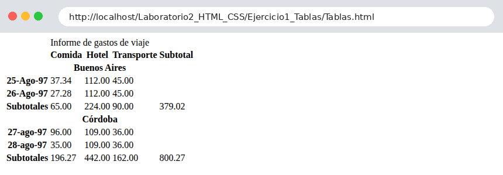
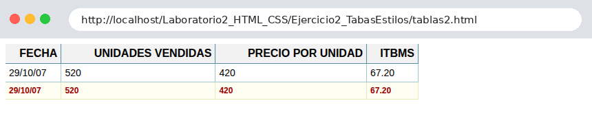
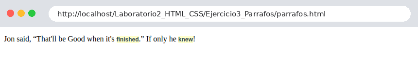
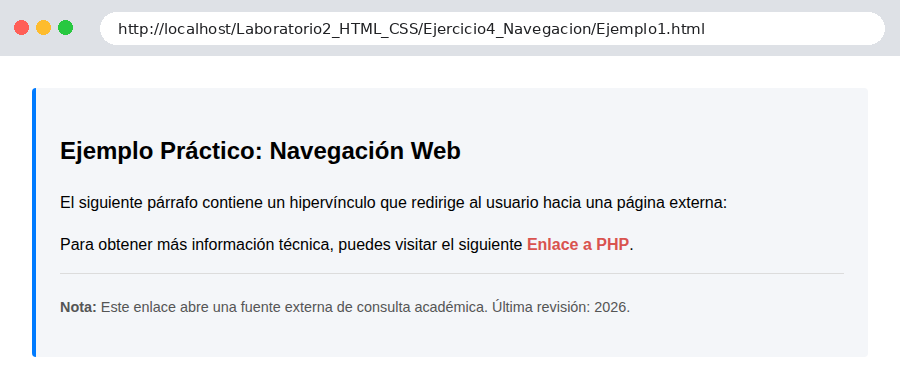
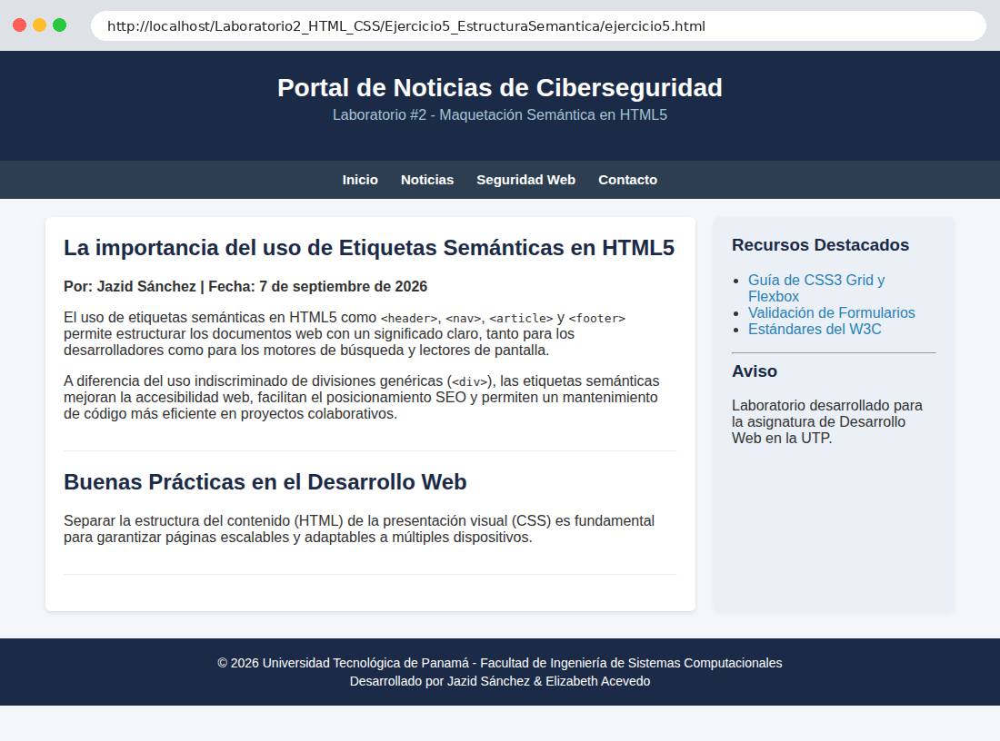
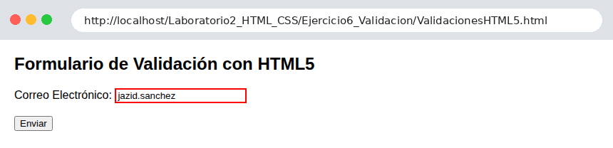
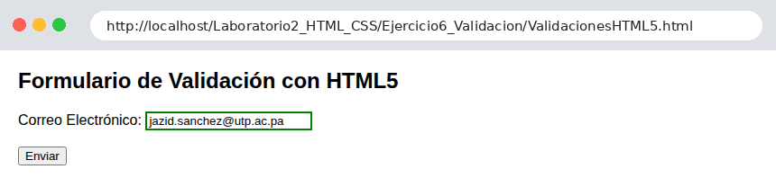
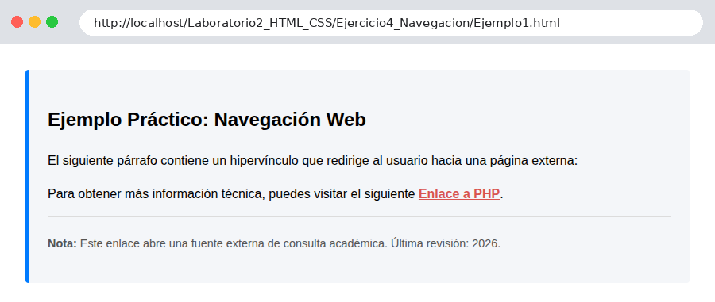
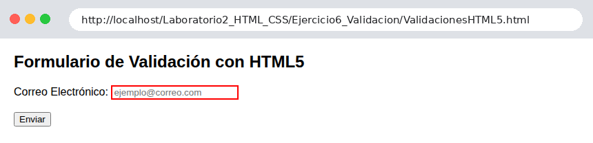

# Laboratorio #2 – HTML5 y CSS3

**Herramientas de la Programación Aplicada I**
**Fecha:** 11/09/2026

Este repositorio contiene el desarrollo de las soluciones prácticas del **Laboratorio #2**, enfocado en la maquetación web estructurada mediante HTML5, la vinculación e implementación de hojas de estilo CSS3 externas, el diseño de tablas estilizadas con clases alternadas, la maquetación semántica y la creación de formularios web con validación nativa.

## 📑 Contenido

1. [Insertar registros](#1--insertar-registros-imágenes)
2. [Evidencia de acciones de Modificar](#2--evidencia-de-acciones-de-modificar-imágenes)
3. [Evidencia de acciones de Eliminar](#3--evidencia-de-acciones-de-eliminar-imágenes)
4. [Controles utilizados](#4--controles-utilizados)
5. [Detalles del laboratorio](#5--detalles-del-laboratorio)
6. [Procesos de instalación](#6--procesos-de-instalación)
7. [Tecnologías y versiones](#7--tecnologías-y-versiones)
8. [Detalles del autor, fecha y referencias](#8--detalles-del-autor-fecha-y-referencias)

> 📌 **Nota:** este laboratorio es **estático** (HTML y CSS, sin PHP ni base de datos). Por eso las acciones se interpretan así: *Insertar* = los datos y el contenido que se ingresan o se muestran en cada ejercicio, *Modificar* = cambiar un valor o un estilo y ver cómo cambia el resultado, y *Eliminar* = borrar el dato ingresado y volver al estado inicial.

---

## 1. 📥 Insertar registros (Imágenes)

### 1.1 Ejercicio 1 – Tablas base (`Ejercicio1_Tablas/Tablas.html`)
Tabla de datos con `<table>`, `<tr>`, `<th>` y `<td>`: informe de gastos de viaje por ciudad, con `caption`, `colspan` y un ícono de pestaña (`favicon`).



### 1.2 Ejercicio 2 – Tablas con estilos (`Ejercicio2_TabasEstilos/tablas2.html`)
Tabla estilizada con una hoja CSS externa y clases alternadas `.modo1` y `.modo2` en las filas.



### 1.3 Ejercicio 3 – Párrafos (`Ejercicio3_Parrafos/parrafos.html`)
Párrafo con cita `<q>` y selector CSS `p strong` que resalta las palabras en negrita.



### 1.4 Ejercicio 4 – Navegación (`Ejercicio4_Navegacion/Ejemplo1.html`)
Hipervínculo externo con selectores de **clase** (`.card-seccion`, `.link-externo`) y de **ID** (`#footer-recurso`).



### 1.5 Ejercicio 5 – Estructura semántica (`Ejercicio5_EstructuraSemantica/ejercicio5.html`)
Maquetación con `<header>`, `<nav>`, `<section>`, `<article>`, `<aside>` y `<footer>`, organizada con Flexbox.



### 1.6 Ejercicio 6 – Validación de formularios (`Ejercicio6_Validacion/ValidacionesHTML5.html`)
El campo de correo es obligatorio: **vacío**, tiene borde **rojo**; al **ingresar un correo válido**, el borde pasa a **verde**.

| Campo vacío | Correo válido ingresado |
|---|---|
|  |  |

---

## 2. ✏️ Evidencia de acciones de Modificar (Imágenes)

### 2.1 Modificar el dato del formulario (Ejercicio 6)
Se escribe un correo incompleto (`jazid.sanchez`) y el campo se marca como inválido; luego se **modifica** el valor a un correo completo y el estilo cambia.

| Antes: correo inválido (borde rojo) | Después: correo corregido (borde verde) |
|---|---|
|  |  |

### 2.2 Modificar el estilo con el cursor (Ejercicio 4)
Al pasar el cursor sobre el enlace, la regla `.link-externo:hover` modifica su estilo y lo subraya.



### 2.3 Modificar el estilo por clase (Ejercicio 2)
Cambiar la clase de una fila de `.modo1` a `.modo2` cambia su presentación (fondo, color y fuente), como se ve en las dos filas de la tabla del [Ejercicio 2](#12-ejercicio-2--tablas-con-estilos-ejercicio2_tabasestilostablas2html).

---

## 3. 🗑️ Evidencia de acciones de Eliminar (Imágenes)

Se borra el contenido del campo de correo (Ejercicio 6); el formulario vuelve al estado inválido inicial.

| Antes de eliminar (campo lleno) | Después de eliminar (campo vacío) |
|---|---|
|  |  |

---

## 4. 🎛️ Controles utilizados

### HTML5

| Elemento / atributo | Uso | Ejercicio |
|---|---|---|
| `<table>`, `<caption>`, `<tr>`, `<th>`, `<td>` | Tablas de datos | 1 y 2 |
| `colspan`, `id`, `headers`, `axis` | Combinación de celdas y asociación de encabezados | 1 |
| `<link rel="shortcut icon">` | Ícono de la pestaña | 1 |
| `<meta>` (`charset`, `viewport`, `description`, `keywords`, `author`, `robots`) | Metadatos de la página | 1 y todos |
| `<p>`, `<q>`, `<strong>` | Texto, citas y énfasis | 3 |
| `<a href target="_blank" rel="noopener">` | Hipervínculo externo | 4 |
| `<header>`, `<nav>`, `<section>`, `<article>`, `<aside>`, `<footer>` | Estructura semántica | 5 |
| `<ul>`, `<li>`, `<hr>`, `<code>` | Listas, separadores y código | 5 |
| `<form>`, `<label>`, `<input type="email">`, `<button type="submit">` | Formulario | 6 |
| Atributos `required`, `placeholder` | Validación nativa del navegador | 6 |

### CSS3

| Selector / propiedad | Uso | Ejercicio |
|---|---|---|
| Hoja externa `<link rel="stylesheet">` | Separar estructura y presentación | 2, 3, 5 y 6 |
| Selectores de clase (`.tabla`, `.modo1`, `.modo2`) | Estilos alternados de filas | 2 |
| Selectores descendientes (`.tabla th`, `p strong`) | Estilos según el contexto | 2 y 3 |
| Selector de ID (`#footer-recurso`) | Estilo para un elemento único | 4 |
| `<style>` interno | Estilos dentro del documento | 4 |
| Pseudoclase `:hover` | Estilo al pasar el cursor | 4 |
| `display: flex`, `gap`, `justify-content`, `flex` | Maquetación con Flexbox | 5 |
| `border-collapse`, `padding`, `text-transform` | Presentación de tablas | 2 |
| `box-shadow`, `border-radius` | Efectos visuales | 4 y 5 |
| Pseudoclases `:required:invalid` y `:required:valid` | Respuesta visual de la validación | 6 |

---

## 5. 🧪 Detalles del laboratorio

| Carpeta | Archivos | Objetivo |
|---|---|---|
| `Ejercicio1_Tablas/` | `Tablas.html`, `img/b_2i10.ico.png` | Estructura base de tablas de datos |
| `Ejercicio2_TabasEstilos/` | `tablas2.html`, `Estilos/estilosTabla.css` | Tablas con hoja de estilos externa y clases alternadas |
| `Ejercicio3_Parrafos/` | `parrafos.html`, `Estilos/estilosParrafos.css` | Texto, citas y selectores descendientes |
| `Ejercicio4_Navegacion/` | `Ejemplo1.html` | Hipervínculos y selectores de clase e ID |
| `Ejercicio5_EstructuraSemantica/` | `ejercicio5.html`, `Estilos/estilos5.css` | Maquetación semántica con Flexbox |
| `Ejercicio6_Validacion/` | `ValidacionesHTML5.html`, `Estilos/estilos6.css` | Formulario con validación nativa y `:valid` / `:invalid` |

### Estructura de carpetas

```text
Laboratorio2_HTML_CSS/
├── Ejercicio1_Tablas/                 # Estructura base de tablas en HTML
│   ├── Tablas.html
│   └── img/b_2i10.ico.png
├── Ejercicio2_TabasEstilos/           # Estilos CSS para tablas
│   ├── tablas2.html
│   └── Estilos/estilosTabla.css
├── Ejercicio3_Parrafos/               # Formato de párrafos y textos
│   ├── parrafos.html
│   └── Estilos/estilosParrafos.css
├── Ejercicio4_Navegacion/             # Enlaces e hipervínculos
│   └── Ejemplo1.html
├── Ejercicio5_EstructuraSemantica/    # Maquetación semántica HTML5
│   ├── ejercicio5.html
│   └── Estilos/estilos5.css
├── Ejercicio6_Validacion/             # Formulario y validación CSS/HTML5
│   ├── ValidacionesHTML5.html
│   └── Estilos/estilos6.css
├── imagenes/                          # Capturas usadas en este README
└── README.md
```

---

## 6. ⚙️ Procesos de instalación

1. **Instalar WampServer** (Windows) o **XAMPP** y ejecutarlo hasta que el ícono quede en **verde**. *(Para estos ejercicios solo HTML/CSS también basta con abrir los archivos en el navegador.)*
2. **Instalar Visual Studio Code** y **Git**.
3. **Clonar el repositorio** dentro de la carpeta `www` (WampServer) o `htdocs` (XAMPP):
   ```bash
   git clone https://github.com/jazidsanchez-create/Laboratorio2_HTML_CSS.git
   cd Laboratorio2_HTML_CSS
   ```
4. **Abrir cada ejercicio en el navegador**, por ejemplo:
   ```text
   http://localhost/Laboratorio2_HTML_CSS/Ejercicio1_Tablas/Tablas.html
   http://localhost/Laboratorio2_HTML_CSS/Ejercicio6_Validacion/ValidacionesHTML5.html
   ```
   También se puede hacer doble clic sobre el archivo `.html` o usar la extensión *Live Server* de Visual Studio Code.

---

## 7. 🌐 Tecnologías y versiones


| Tecnología | Versión |
|---|---|
| HTML | HTML5 |
| CSS | CSS3 |
| Apache | 2.4.x *(incluido en WampServer)* |
| WampServer | 3.x |
| Navegador | Chrome / Edge / Firefox en su versión actual |
| Visual Studio Code | Última versión estable |
| Git | 2.x |

---

## 8. 👨‍💻 Detalles del autor, fecha y referencias

**Autor:** Jazid Sánchez
**Colaboración (Ejercicio 5):** Elizabeth Acevedo
**Institución:** Universidad Tecnológica de Panamá (UTP)
**Facultad:** Facultad de Ingeniería de Sistemas Computacionales
**Carrera:** Licenciatura en Ciberseguridad

📧 **Email:** jazid.sanchez@utp.ac.pa
🌐 **GitHub:** https://github.com/jazidsanchez-create

📅 **Fecha de realización:** 11/09/2026
📅 **Última actualización del README:** 10/10/2026

### 📚 Referencias

* MDN Web Docs. (2026). *HTML table basics*. https://developer.mozilla.org/es/docs/Learn/HTML/Tables/Basics
* MDN Web Docs. (2026). *Elementos semánticos de HTML*. https://developer.mozilla.org/es/docs/Glossary/Semantics
* MDN Web Docs. (2026). *Validación de formularios del lado del cliente*. https://developer.mozilla.org/es/docs/Learn/Forms/Form_validation
* MDN Web Docs. (2026). *Pseudoclases `:valid` e `:invalid`*. https://developer.mozilla.org/es/docs/Web/CSS/:invalid
* W3Schools. (2026). *CSS Tutorial*. https://www.w3schools.com/css/
